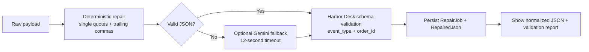

# JSON Repair Desk

JSON Repair Desk is a small Laravel + Vue workbench for repairing slightly malformed Harbor Desk event payloads and validating the result against a required event schema. It fixes trailing commas and single-quoted strings deterministically before considering an optional Gemini fallback.

## How the repair works



The deterministic repairer runs first on every request. Gemini runs only when the result still cannot be parsed as JSON; its response must itself parse before it is considered. The schema check is performed after either path and is never delegated to the model. The LLM boundary is `App\Services\Llm\LlmClient`; the application binds a `FakeLlmClient` when no key is configured and `GeminiLlmClient` when `GEMINI_API_KEY` is present. Model and network failures fall back to a readable invalid result instead of an unhandled server error.

## Run locally

Requirements: PHP 8.3+, Composer, Node.js 22+, and npm. No API key, Redis, or external service is required for the local demo.

```bash
composer setup
php artisan db:seed
```

`composer setup` creates `.env` and the local SQLite database, migrates it, installs PHP and Node dependencies, and builds the Vue assets. Start Laravel and Vite in separate terminals:

```bash
php artisan serve
```

```bash
npm run dev
```

Open <http://127.0.0.1:8000>. Without `GEMINI_API_KEY`, deterministic repairs and schema validation work as usual; malformed inputs that need a model remain visible as invalid. To enable the optional Gemini syntax fallback, add `GEMINI_API_KEY=...` to `.env` and restart the app. The default model is `gemini-2.5-flash` and can be changed with `GEMINI_MODEL`.

There is no login or demo credential. The home page includes three ready-to-try examples: a trailing comma, single quotes, and a valid JSON payload missing `event_type`. `php artisan db:seed` also writes these sample jobs and their expected results to the local database.

## Tests

```bash
php artisan test
```

The Pest suite verifies that trailing commas become valid JSON, missing `event_type` remains a schema error, guest submissions return HTTP 200 and persist their result, single quotes preserve escaped apostrophes, and the no-key service binding uses the fake LLM. The tests require no network access or Gemini credentials.

## Data model

- `RepairJob`: raw input and processing status (`valid` or `invalid`).
- `RepairedJson`: normalized JSON (nullable when syntax is unrecoverable), schema validity, and a JSON list of errors; each result belongs to one repair job.

The v1 Harbor Desk event schema requires a JSON object containing non-empty string values for `event_type` and `order_id`.
